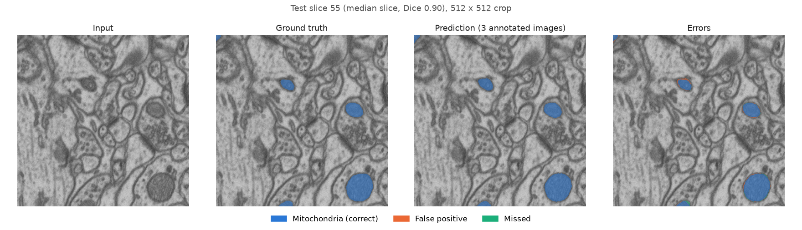

# Mitochondria segmentation with few annotations

How many annotated images does a U-Net need to segment electron-microscopy images?
This project trains the same U-Net on **3, 10 and 30 annotated images** and compares the results.

## Dataset

[EPFL Hippocampus](https://www.epfl.ch/labs/cvlab/data/data-em/) (Lucchi et al., 2012), an
electron-microscopy volume of a mouse brain with mitochondria annotated.
165 training images and 165 test images of 768 x 1024 pixels.

## Method

- **Model:** U-Net (Ronneberger et al., 2015), written from scratch in PyTorch
- **Loss:** binary cross-entropy + Dice (mitochondria are only a small part of the pixels)
- **Training:** random 256 x 256 patches, same number of steps for 3, 10 or 30 images
  (20 epochs x 400 patches, AdamW, learning rate 1e-3 with a cosine schedule)
- **Data augmentation:** random rotations and flips
- **Metric:** Dice score on 33 evenly spaced test slices, mean ± std over 5 seeds

## Results

Test Dice, mean ± std over 5 seeds.

| Annotated images | Cosine schedule (final setup) | Constant learning rate |
|---|---|---|
| 3 | 0.891 ± 0.004 | 0.872 ± 0.026 |
| 10 | **0.913 ± 0.003** | 0.887 ± 0.025 |
| 30 | **0.913 ± 0.003** | 0.892 ± 0.019 |



*Model trained on 3 annotated images with the cosine schedule, on the median test slice.*

### Observations

- Going from 3 to 10 annotated images adds 0.022 of Dice, but going from 10 to 30 adds nothing,
  both reach 0.913. Even 3 images already give 0.891.
- With a constant learning rate, the std between seeds was about 0.02, as large as the differences
  between 3, 10 and 30 images. With the cosine schedule the std drops below 0.005 and the mean goes up
  by about 0.02.
- The model finds the mitochondria, its errors are mostly on their borders (see the figure).

### Limits

The training and test volumes come from the same brain region and the same microscope.
Another tissue or microscope would probably need more annotations.

## Installation

```bash
pip install -r requirements.txt
```

On Windows, `pip` may install a CPU-only PyTorch. To train on an NVIDIA GPU, install the CUDA build
given by [pytorch.org](https://pytorch.org/get-started/locally/), for example

```bash
pip install torch --index-url https://download.pytorch.org/whl/cu132
```

## Usage

The trained models are included in `models/`, so the demo works right away.

```bash
streamlit run app.py      # demo, compares the 3 models on example test slices or on your own image
python main.py            # downloads the data, trains 3 x 5 models (about 15 min on a recent GPU), prints the results
pytest                    # tests (pip install -r requirements-dev.txt)
```

Running `main.py` replaces the models in `models/`.

## Project structure

```
main.py           configuration and experiment
app.py            Streamlit demo
src/dataset.py    data loading, random patches, augmentation
src/model.py      U-Net
src/train.py      loss, training loop, evaluation
src/predict.py    prediction on a full image
models/           trained models (3, 10 and 30 annotated images)
tests/            unit tests
assets/           figure of the README
examples/         3 test slices and their masks, used by the demo
```
